# 推理优化实验

> 本页整理自 2026-11-09 已有实验图文，展示整理前实验版本的历史实测；本仓库重构后的 GPU 入口尚未完成性能回归。图表保留各自的输入、配置和统计口径，不代表任意设备或版本的通用收益。

[独立 HTML 页面](index.html) · [测量口径](measurement.md) · [代码与复现入口](../README.md)

## 投机解码

### 投机解码并发对照

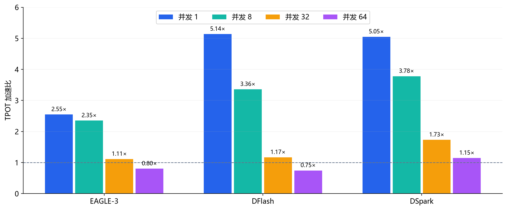

基准：同轮实验、同并发的 BF16 无投机 Qwen3-8B；聊天 / 代码 / 数学三来源等权几何平均。固定 γ：EAGLE-3=6、DFlash=15、DSpark=8；固定 3 GiB KV 池、输出 256 token。

并发 1 / 8 每类 24 条输入；并发 32 / 64 复用同一批输入构造每轮 192 请求。64 并发部分代码 / 数学配置发生抢占。

**64 并发 KV 抢占次数（启动 1 / 启动 2）**

| 方案 | 聊天 | 代码 | 数学 |
|---|---|---|---|
| BF16 无投机 | 0 / 0 | 86 / 85 | 6 / 6 |
| EAGLE-3（γ=6） | 0 / 0 | 48 / 53 | 0 / 0 |
| DFlash（γ=15） | 0 / 0 | 142 / 130 | 13 / 14 |
| DSpark（γ=8） | 0 / 0 | 97 / 98 | 8 / 9 |

表内“启动 1 / 启动 2”为两次独立启动的抢占事件数；每次统计区间包含 2 轮、每轮 192 请求。数据来自服务端累计抢占计数器的区间差；同一请求可被多次抢占，不等于受影响请求数。并发 32 的三来源各方案均为 0。

固定 KV 池下的高并发结果包含调度与 KV 回收重算影响，不能将全部退化归因于计算饱和。

| 方案 | 并发 1 | 并发 8 | 并发 32 | 并发 64 |
|---|---|---|---|---|
| EAGLE-3 | 2.55× | 2.35× | 1.11× | 0.80× |
| DFlash | 5.14× | 3.36× | 1.17× | 0.75× |
| DSpark | 5.05× | 3.78× | 1.73× | 1.15× |

#### EAGLE-3 分来源加速比

| 输入来源 | 并发 1 | 并发 8 | 并发 32 | 并发 64 |
|---|---|---|---|---|
| 聊天 | 2.04× | 1.92× | 0.94× | 0.68× |
| 代码 | 3.55× | 3.14× | 1.45× | 1.09× |
| 数学 | 2.28× | 2.16× | 1.01× | 0.69× |

#### DFlash 分来源加速比

| 输入来源 | 并发 1 | 并发 8 | 并发 32 | 并发 64 |
|---|---|---|---|---|
| 聊天 | 4.63× | 2.94× | 1.05× | 0.66× |
| 代码 | 6.29× | 4.23× | 1.45× | 0.98× |
| 数学 | 4.66× | 3.05× | 1.05× | 0.64× |

#### DSpark 分来源加速比

| 输入来源 | 并发 1 | 并发 8 | 并发 32 | 并发 64 |
|---|---|---|---|---|
| 聊天 | 4.42× | 3.55× | 1.63× | 1.05× |
| 代码 | 5.59× | 3.93× | 1.79× | 1.28× |
| 数学 | 5.21× | 3.87× | 1.78× | 1.12× |

各格基准为同轮实验、同并发、同输入的无投机模型；低于 1× 表示 TPOT 退化。并发 64 的部分结果包含 KV 抢占。

输入来源：MT-Bench 首轮 / HumanEval / GSM8K，分别记为聊天 / 代码 / 数学；任务名称按来源划分。

### EAGLE-3 投机长度

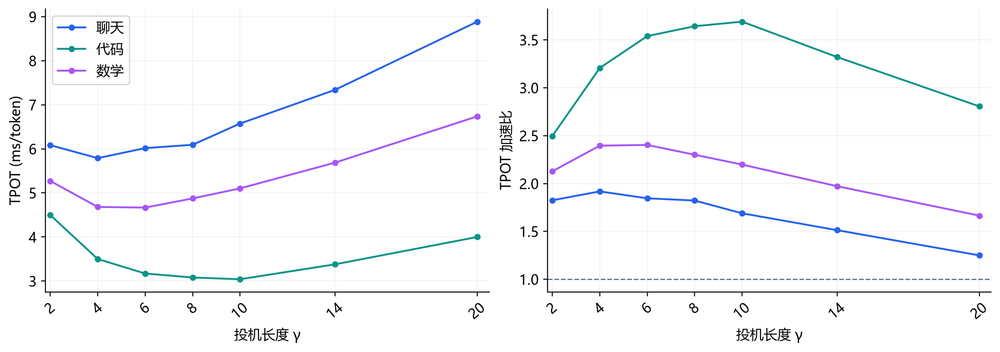

基准：对应调参来源的 BF16 无投机模型，聊天 / 代码 / 数学 TPOT 分别约 11.102 / 11.224 / 11.215 ms/token。单并发，每类 8 条调参输入，固定输出 256 token；与留出并发对照分开。

| 输入 | 已测最低 TPOT 的 γ | TPOT（ms/token） | 相对基准加速比 |
|---|---|---|---|
| 聊天 | 4 | 5.789 | 1.92× |
| 代码 | 10 | 3.041 | 3.69× |
| 数学 | 6 | 4.667 | 2.40× |

### DFlash 投机长度

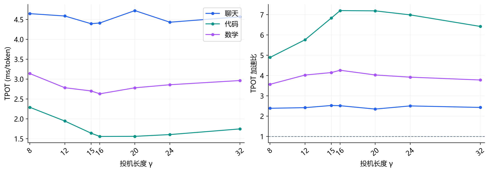

基准：对应调参来源的 BF16 无投机模型，聊天 / 代码 / 数学 TPOT 分别约 11.102 / 11.224 / 11.215 ms/token。单并发，每类 8 条调参输入，固定输出 256 token；与留出并发对照分开。

| 输入 | 已测最低 TPOT 的 γ | TPOT（ms/token） | 相对基准加速比 |
|---|---|---|---|
| 聊天 | 15 | 4.394 | 2.53× |
| 代码 | 16 | 1.558 | 7.20× |
| 数学 | 16 | 2.630 | 4.26× |

### DSpark 投机长度

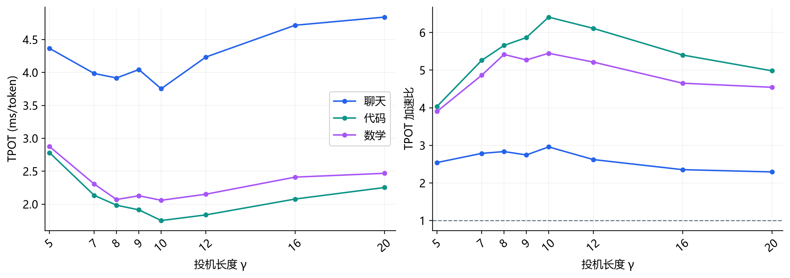

基准：对应调参来源的 BF16 无投机模型，聊天 / 代码 / 数学 TPOT 分别约 11.102 / 11.224 / 11.215 ms/token。单并发，每类 8 条调参输入，固定输出 256 token；与留出并发对照分开。

| 输入 | 已测最低 TPOT 的 γ | TPOT（ms/token） | 相对基准加速比 |
|---|---|---|---|
| 聊天 | 10 | 3.753 | 2.96× |
| 代码 | 10 | 1.751 | 6.41× |
| 数学 | 10 | 2.058 | 5.45× |

### WikiText 投机长度

以下三图使用 8 条固定 WikiText 续写输入，输入 128 / 输出 256 token、单并发，每点 3 批。接受长度不含 bonus token；自动 KV 池扫描与前述固定池任务实验分开。

### EAGLE-3 WikiText

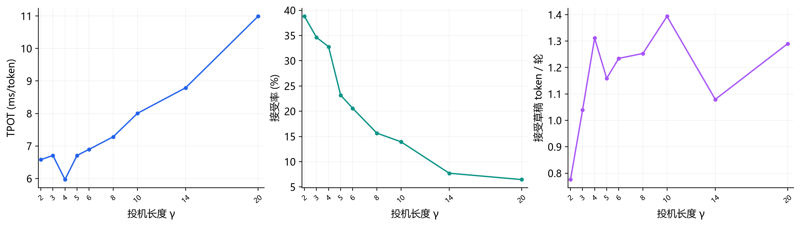

基准：BF16 无投机；历史点匹配原扫描前后 anchor，补测点匹配补测前后 anchor。参考速度比仅作探索性比较，不冒充逐点同启动配对结果。

| γ | TPOT（ms/token） | 对应基准（ms/token） | 参考速度比 |
|---|---|---|---|
| 4 | 5.968 | 10.783 | 1.81× |
| 20 | 10.988 | 10.783 | 0.98× |

### DFlash WikiText

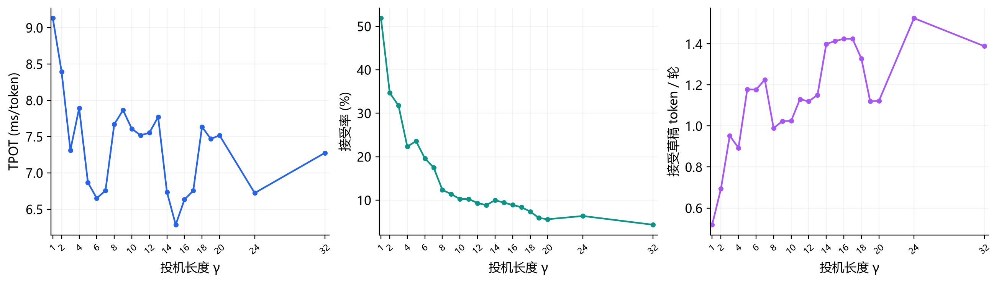

基准：BF16 无投机；历史点匹配原扫描前后 anchor，补测点匹配补测前后 anchor。参考速度比仅作探索性比较，不冒充逐点同启动配对结果。

| γ | TPOT（ms/token） | 对应基准（ms/token） | 参考速度比 |
|---|---|---|---|
| 15 | 6.286 | 10.547 | 1.68× |
| 32 | 7.276 | 11.236 | 1.54× |

固定 **3 GiB KV 池**独立启动确认：γ=15 / 16 / 20 的 TPOT 为 **6.529 / 6.793 / 7.628 ms/token**；这组确认值不与图中自动池点拼接。

### DSpark WikiText

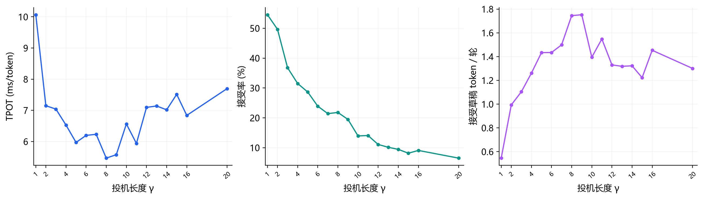

基准：BF16 无投机；历史点匹配原扫描前后 anchor，补测点匹配补测前后 anchor。参考速度比仅作探索性比较，不冒充逐点同启动配对结果。

| γ | TPOT（ms/token） | 对应基准（ms/token） | 参考速度比 |
|---|---|---|---|
| 8 | 5.467 | 11.099 | 2.03× |
| 20 | 7.696 | 11.099 | 1.44× |

独立启动确认：γ=8 / 9 / 10 的 TPOT 为 **5.497 / 5.540 / 6.710 ms/token**。DFlash γ>15、DSpark γ>7 属于 checkpoint 训练长度外推。

### DFlash 服务端计数器

代码调参输入 8 条、单并发、每条输出 256 token；各 γ 两轮，总输出均为 4096 token。计数器取测量前后差值，核验服务端输出总数与请求总数一致。

| γ | TPOT（ms/token） | 草稿轮数 | 生成草稿数 | 接受草稿数 | 接受率 | 每轮接受草稿数 |
|---|---|---|---|---|---|---|
| 16 | 1.558 | 650 | 10,400 | 3,502 | 33.67% | 5.388 |
| 20 | 1.561 | 652 | 13,040 | 3,518 | 26.98% | 5.396 |
| 24 | 1.605 | 678 | 16,272 | 3,522 | 21.64% | 5.195 |
| 32 | 1.748 | 696 | 22,272 | 3,474 | 15.60% | 4.991 |

接受率 = 接受草稿数 / 生成草稿数；每轮接受草稿数 = 接受草稿数 / 草稿轮数，不含 bonus token，不能直接当作每轮最终输出数。

γ=16→32：TPOT 1.558→1.748 ms/token，每轮接受草稿数 5.388→4.991；各档抢占均为 0。两档共 16 对请求的最终 256-token ID 序列全部相同，但草稿轮起点不保证相同。

### DFlash NVTX 关联分段

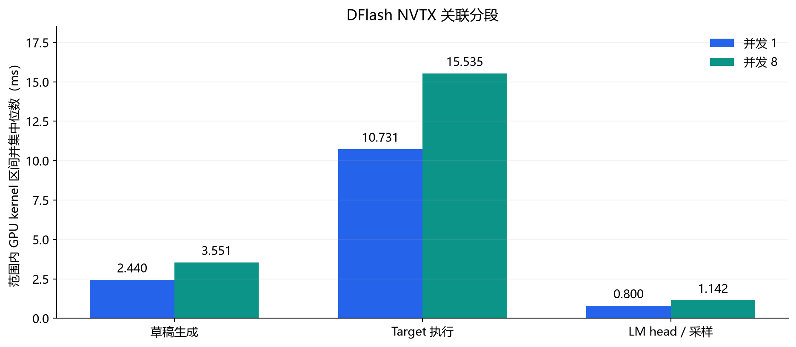

数学输入，γ=15；诊断采集与正式测速分开。通过 CUDA launch correlation 将 NVTX 范围关联至 GPU kernel，图示为范围内 kernel 执行区间并集的中位数。

| 执行范围 | 并发 1（ms） | 并发 8（ms） |
|---|---|---|
| 草稿生成 | 2.440 | 3.551 |
| Target 执行 | 10.731 | 15.535 |
| LM head / 采样 | 0.800 | 1.142 |

`Target 执行`包含 prefill、decode/验证及准备，不是纯验证。

### 逐 token 输出一致性

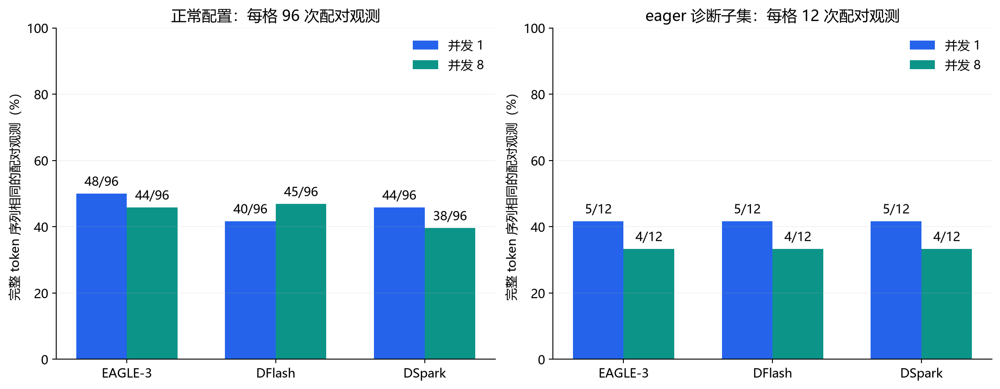

相同 Qwen3-8B、tokenizer、非思考模板与贪心设置；EAGLE-3 / DFlash / DSpark 的 γ=6 / 15 / 8。正常配置使用 24 条输入，eager 另用 12 条诊断子集；图中分子为完整 token 序列相同次数，分母为配对观测数，包含重复。

输入包含已知分歧样本，图中比例不代表真实业务发生率；两面板样本不同，不能直接按柱高比较 Graph 与 eager 的改善。

| 无投机基线自身重复 | 完全相同 / 配对观测 | 出现分歧的独立输入 |
|---|---|---|
| 并发 1 | 48/48 | 0/24 |
| 并发 8 | 26/48 | 13/24 |

无投机在 8 并发下自身已有分歧；eager 未消除投机与无投机的分歧，不能仅归因于 CUDA Graph。

### 首次分歧的原执行轨迹概率

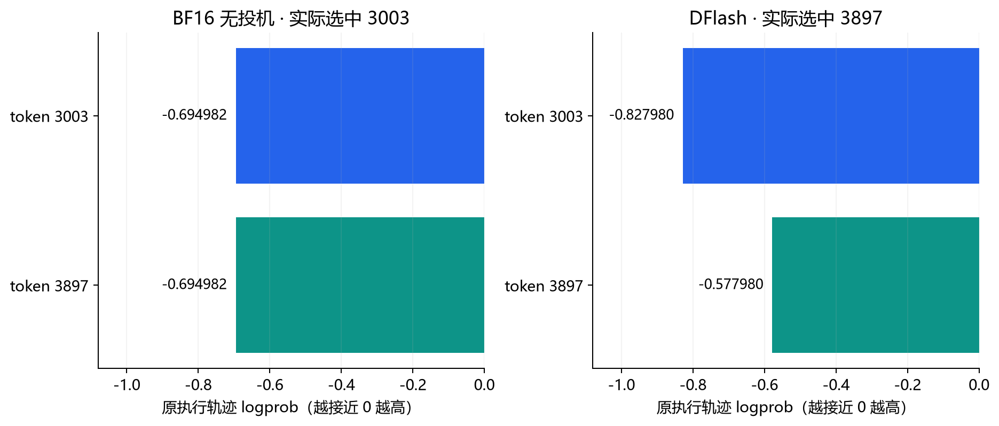

样本 chat_124，单并发、DFlash γ=15。两条轨迹前 4 个 token ID 相同，在位置 4（从 0 起）首次分歧；图示该位置原执行轨迹报告的候选 logprob。

| 候选 token ID | BF16 无投机 logprob | DFlash logprob |
|---|---|---|
| 3003 | -0.694982 | -0.827980 |
| 3897 | -0.694982 | -0.577980 |

无投机候选并列，实际选中 3003；DFlash 选中 3897。审计获得 107 次可对齐的首次分歧概率记录；118,331 个带 logprob 的输出 token 中，低于各自路径报告最高概率的观测为 0（容差 1e-4）。

top5 只提供局部证据；各自符合 greedy 选择不代表两条路径概率相同，也不代表所有分歧均无害。共同前缀重新 prefill 的早期探针与这里的原轨迹采集分开。

## 量化

### 量化性能

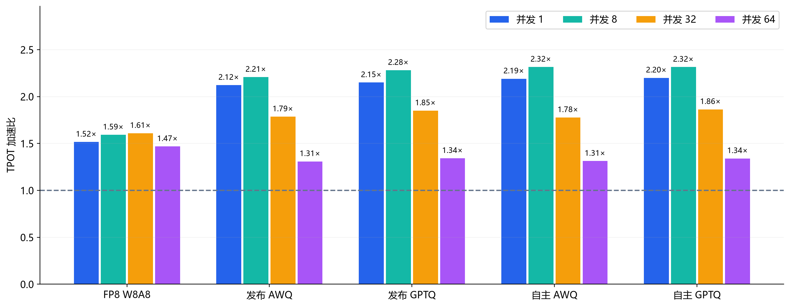

基准：同轮实验、同并发的 BF16 Qwen3-8B；三来源等权几何平均。固定 3 GiB KV 池、输出 256 token，两次独立启动并反转顺序。自主权重使用 128 段校准，AWQ / GPTQ 部署后端为 Marlin。

**64 并发 KV 抢占次数（启动 1 / 启动 2）**

| 方案 | 聊天 | 代码 | 数学 |
|---|---|---|---|
| BF16 | 0 / 0 | 86 / 86 | 6 / 6 |
| FP8 W8A8 | 0 / 0 | 86 / 85 | 6 / 6 |
| 发布 AWQ | 0 / 0 | 84 / 85 | 6 / 6 |
| 发布 GPTQ | 0 / 0 | 86 / 86 | 6 / 6 |
| 自主 AWQ | 0 / 0 | 86 / 86 | 6 / 6 |
| 自主 GPTQ | 0 / 0 | 86 / 86 | 6 / 6 |

表内“启动 1 / 启动 2”为两次独立启动的抢占事件数；每次统计区间包含 2 轮、每轮 192 请求。数据来自服务端累计抢占计数器的区间差；同一请求可被多次抢占，不等于受影响请求数。并发 32 的三来源各方案均为 0。

**BF16 在 64 并发下的 KV 占用采样峰值**

| 输入来源 | 启动 1 | 启动 2 |
|---|---|---|
| 聊天 | 98.02% | 96.92% |
| 代码 | 99.93% | 99.93% |
| 数学 | 99.71% | 99.78% |

服务启动日志报告 KV 槽位为 **21,840 token**；占用率约每 0.5 秒采样，可能漏掉短暂峰值。代码 / 数学配置接近满池。本组 W8A8 / W4A16 均未量化 KV，KV 仍为 BF16，且固定池不自动扩容，因此权重量化并未消除本组 KV 抢占。

| 方案 | 并发 1 | 并发 8 | 并发 32 | 并发 64 |
|---|---|---|---|---|
| FP8 W8A8 | 1.52× | 1.59× | 1.61× | 1.47× |
| 发布 AWQ | 2.12× | 2.21× | 1.79× | 1.31× |
| 发布 GPTQ | 2.15× | 2.28× | 1.85× | 1.34× |
| 自主 AWQ | 2.19× | 2.32× | 1.78× | 1.31× |
| 自主 GPTQ | 2.20× | 2.32× | 1.86× | 1.34× |

并发 1 / 8 每类 24 个请求；并发 32 / 64 每类 24 条输入复用为每轮 192 请求。各点两轮、两次独立启动；高低并发属于不同实验批次，不共用跨并发基准。

高并发部分配置发生 KV 抢占；加速比包含相同固定池约束下的调度与重算影响。

### 量化显存与容量

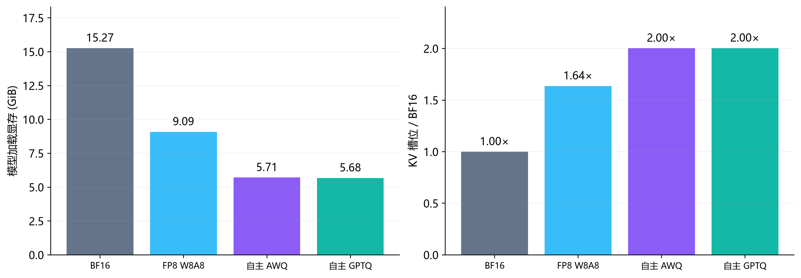

基准：BF16 模型加载显存 **15.27 GiB**、KV 槽位 **69,776 token**。相同 **80% 总显存预算**下，FP8 / 自主 AWQ / 自主 GPTQ 的槽位比为 **1.64× / 2.00× / 2.00×**；槽位数不等于满足延迟 SLO 的最大并发。

### 校准预算与质量

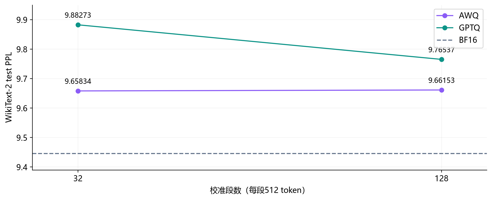

PPL 基准：BF16 **9.44564**。校准用 WikiText-2 train，PPL 用独立 test；32 段为 128 段的嵌套子集。代码为 156 条隔离执行测试，数学为 128 条宽松提取匹配；不作为官方完整榜单分数。

| 方案 | PPL | 代码通过 /156 | 格式遵从 /128 | 严格匹配 /128 | 无合法格式但宽松匹配 /128 | 宽松匹配合计 /128 |
|---|---|---|---|---|---|---|
| BF16 | 9.44564 | 129 | 73 | 70 | 48 | 118 |
| FP8 W8A8 | 9.45265 | 130 | 57 | 56 | 66 | 122 |
| 发布 AWQ | 9.88097 | 130 | 105 | 98 | 18 | 116 |
| 发布 GPTQ | 9.83534 | 126 | 36 | 35 | 83 | 118 |
| 自主 AWQ / 32段 | 9.65834 | 127 | 105 | 102 | 18 | 120 |
| 自主 AWQ / 128段 | 9.66153 | 128 | 110 | 105 | 15 | 120 |
| 自主 GPTQ / 32段 | 9.88273 | 121 | 42 | 40 | 79 | 119 |
| 自主 GPTQ / 128段 | 9.76537 | 123 | 93 | 90 | 30 | 120 |

格式遵从：可提取到 `#### 数值`；严格匹配：该数值与标准答案相等；宽松匹配：无合法 `#### 数值` 时使用输出中的最后一个数值，有合法格式时仍以其答案为准。格式标记未严格限定在末行；宽松提取不等于人工复核准确率。

### 原生 FP8 KV

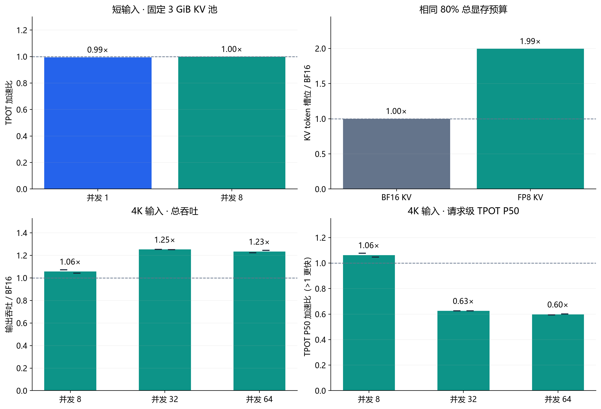

基准：**BF16 KV / TRITON_ATTN**。权重保持 BF16，使用 vLLM 原生 FP8 E4M3 KV 路径（含 Q 量化）；独立调参输入校准并核验 **108 个 Q/K/V scale**。

短输入固定 **3 GiB KV 池**，三来源 TPOT 加速比取等权几何平均。长输入采用 **80% 显存预算、4096 输入 / 256 输出**，两次启动反转顺序，每点两轮；短横线为各启动值。槽位 **69,808 → 139,232**，不代表 SLO 并发上限。

#### 长输入并发对照

| 并发 | BF16 TPOT P50 | FP8 TPOT P50 | BF16 TPOT P99 | FP8 TPOT P99 | P50 加速比 | BF16 token/s | FP8 token/s | 吞吐比 |
|---|---|---|---|---|---|---|---|---|
| 8 | 25.28 | 23.79 | 27.97 | 26.63 | 1.06× | 268 | 283 | 1.06× |
| 32 | 44.33 | 70.84 | 46.65 | 73.44 | 0.63× | 330 | 413 | 1.25× |
| 64 | 44.36 | 74.18 | 46.32 | 81.85 | 0.60× | 332 | 410 | 1.23× |

倍率为两次启动配对结果的中位数；8 条输入复用为每轮 32 / 64 / 128 请求，关闭前缀缓存。

TPOT 单位为 ms/token。P99 按每轮请求计算，再对两轮、两次启动逐级取中位数；不是逐 token ITL P99。每轮样本有限，尾部分位数仅作描述性参考。

| 并发 | BF16 抢占事件（启动1 / 2） | FP8 抢占事件（启动1 / 2） | BF16 running 峰值 | FP8 running 峰值 | BF16 TTFT P50 ms | FP8 TTFT P50 ms |
|---|---|---|---|---|---|---|
| 8 | 0 / 0 | 0 / 0 | 8 / 8 | 8 / 8 | 1155 | 1130 |
| 32 | 0 / 0 | 0 / 0 | 16 / 16 | 32 / 32 | 13259 | 1211 |
| 64 | 0 / 0 | 6 / 6 | 16 / 16 | 33 / 33 | 37756 | 20880 |

抢占为每次启动两轮的事件数；running 为采样峰值。长输入结果包含 KV 容量与调度影响。

#### 质量校验

| 方案 | WikiText-2 PPL | 代码通过 /156 | 数学宽松匹配 /128 |
|---|---|---|---|
| BF16 KV / Triton | 9.44561 | 129 | 119 |
| FP8 KV / Triton | 9.33159 | 130 | 120 |

同后端独立留出，允许自然 EOS，最多 1024 输出；小幅分数差异不代表质量提升，未覆盖长上下文生成质量。

## Chunked Prefill

### Chunked Prefill

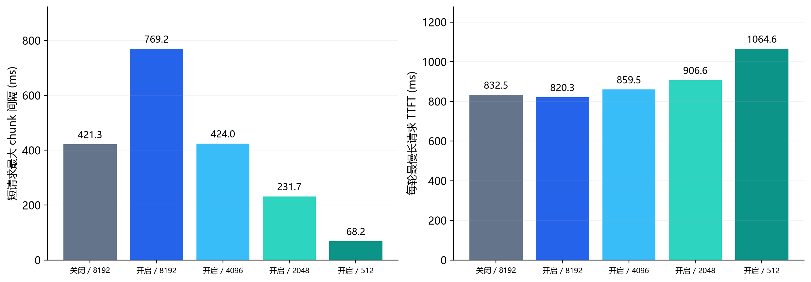

对照：关闭 / 8192，以及开启状态下的 8192 / 4096 / 2048 / 512 预算。8 条短请求解码期间注入 2 条约 4K 输入长请求；各指标先按轮计算，再取三轮中位数。开启 8192→512：短请求最大 chunk 间隔 **769.2→68.2 ms**，每轮最慢长请求 TTFT **820.3→1064.6 ms**。

短请求 TPOT P50 为 **13.115～13.261 ms/token**；chunk 间隔不是逐 token ITL。

## Split-K

### Split-K

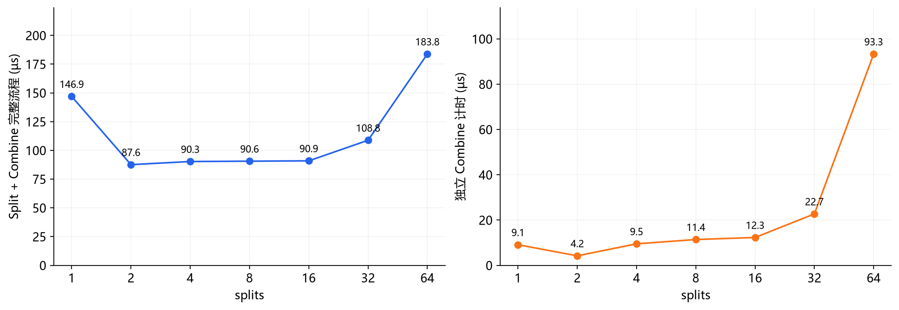

基准：同一主扫描的 **splits=1 完整流程 146.9 µs**，各档均含 Combine。单头、连续 KV、非因果，Q / K / V=[4096,128]，BM=64；沿 KV 序列维切分。右图为另一独立分段批次，不能与左图按点相加。

| splits | 1 | 2 | 4 | 8 | 16 | 32 | 64 |
|---|---|---|---|---|---|---|---|
| 完整延迟（µs） | 146.9 | 87.6 | 90.3 | 90.6 | 90.9 | 108.8 | 183.8 |
| 相对 splits=1 加速比 | 1.00× | 1.68× | 1.63× | 1.62× | 1.62× | 1.35× | 0.80× |
